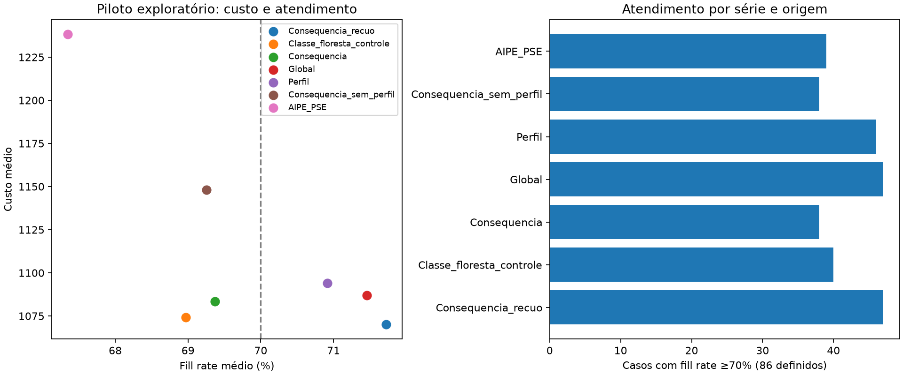

# Comparação reduzida do AIPE: seleção por consequências e recuo

Execução: 15/10/2026. Rodada canônica: `m5_pse_consequences30_v2_2026-10-15`.

**Resultado:** a seleção por custo e serviço previstos, com recuo à referência, apresentou o melhor compromisso observado neste piloto: custo 1,56% menor e fill rate médio 0,27 ponto percentual maior que a seleção global. Contudo, mudou apenas três de 90 decisões, concentradas em duas lojas, e não aumentou a quantidade de casos que atingem 70%. É evidência exploratória para continuar investigando, não comprovação de superioridade generalizável.

## Escopo e execução

Foram reutilizados todos os resultados concluídos das sete políticas do piloto M5: 30 séries FOODS, dez lojas, três origens (50, 64, 78), 90 casos série/origem. Há 86 casos com demanda positiva no teste e quatro com serviço indefinido. Custos incluem os 90; médias de serviço incluem os 86 definidos. O piloto não representa todas as FOODS e já foi observado durante o desenvolvimento.

Nenhuma simulação de estoque, ajuste de controlador ou treinamento de RL foi repetido. Apenas os seletores foram ajustados. A comparação canônica levou aproximadamente 25 segundos, em CPU, com uma thread por estimador e prioridade abaixo do normal. Bahia e as execuções amplas do M5/Brasil não foram iniciadas. Uma rodada preliminar v1 foi preservada; a v2 acrescenta o classificador de controle com a mesma regularização das florestas e snapshots do código. Não houve escolha da versão pelo resultado: as três variantes por consequência têm os mesmos resultados nas duas execuções.

## Desenho

Cada origem é analisada separadamente. A loja externa fica excluída de todos os ajustes. As características vêm do prefixo de treinamento; os alvos de custo e serviço são as médias das simulações na validação, entre sementes. Não se misturam origens futuras.

O seletor por consequências usa duas florestas ExtraTrees multioutput: uma prevê log(1+custo), outra prevê fill rate das sete políticas. Cada floresta possui 64 árvores, profundidade máxima quatro e no mínimo três observações por folha; hiperparâmetros fixados antes da comparação. A previsão de custo é transformada de volta e usada para escolher a política prevista como mais barata entre as que alcançam 70% de serviço. Se nenhuma for prevista como viável, escolhe o maior serviço previsto, com desempate por custo.

A variante conservadora só substitui a referência global quando a candidata tem serviço previsto de pelo menos 70%, serviço previsto não inferior ao da referência e redução prevista de custo acima de uma margem. A margem é escolhida entre 0%, 2%, 5%, 10% e recuo permanente. A seleção acontece em validação interna por loja: as florestas internas são treinadas em oito lojas; a margem minimiza custo observado nas lojas internas excluídas, sujeita a serviço médio não inferior à referência correspondente. Depois, as florestas externas são ajustadas em nove lojas e recomendam para a décima. Não se trata de uma garantia estatística de segurança.

O controle `Classe_floresta_controle` usa rótulos de política vencedora, com a mesma família, número de árvores, profundidade, suporte mínimo e características da floresta por consequências. Ajuda a separar o efeito de regularização do efeito de representar os resultados operacionais; não iguala matematicamente as perdas e tarefas dos modelos. A ablação sem perfil foi feita no seletor por consequências sem recuo; não se avaliou recuo sem perfil nesta rodada.

O protocolo, margens e hashes foram gravados antes dos ajustes; todas as recomendações foram persistidas antes da leitura do teste para pontuação. Isso impede ajuste automático pelo teste nesta execução, mas **não torna independente um piloto que já orientou o desenvolvimento**. Os comparadores existentes preservam seus objetivos originais: global/perfil usam serviço médio do grupo; o seletor por consequências impõe serviço individual previsto. Essa diferença ainda deve ser harmonizada no experimento confirmatório.

## Comparação no teste

| Estratégia | Custo médio | Fill rate médio | Casos ≥70% / 86 | Custo vs. global | Serviço vs. global |
|---|---:|---:|---:|---:|---:|
| Consequências com recuo | 1.070,03 | 71,72% | 47 | −1,56% | +0,27 p.p. |
| Classe vencedora, floresta de controle | 1.074,17 | 68,97% | 40 | −1,18% | −2,49 p.p. |
| Consequências sem recuo | 1.083,36 | 69,37% | 38 | −0,33% | −2,09 p.p. |
| Seleção global | 1.086,97 | 71,46% | 47 | referência | referência |
| PSE por perfil | 1.094,02 | 70,91% | 46 | +0,65% | −0,54 p.p. |
| Moda dos rótulos | 1.096,65 | 68,85% | 42 | +0,89% | −2,60 p.p. |
| Consequências sem perfil e sem recuo | 1.148,09 | 69,25% | 38 | +5,62% | −2,20 p.p. |
| Escolha individual da validação | 1.185,13 | 68,38% | 44 | +9,03% | −3,08 p.p. |
| PSE preditivo original, com/sem perfil | 1.238,30 | 67,35% | 39 | +13,92% | −4,11 p.p. |

## As três intervenções

| Origem | Loja e série | Referência → recomendação | Custo: referência → AIPE | Serviço: referência → AIPE |
|---|---|---|---:|---:|
| 50 | CA_2 / FOODS_1_096 | CappedBaseStock → GA | 481,76 → 359,24 | 97,02% → 100,00% |
| 78 | TX_2 / FOODS_2_084 | EOQCycle → sSCycle | 253,29 → 251,62 | 64,43% → 68,84% |
| 78 | TX_2 / FOODS_3_135 | EOQCycle → sSCycle | 7.891,79 → 6.491,33 | 31,64% → 47,27% |

A candidata foi prevista como viável para permitir essas trocas, mas **duas das três permaneceram abaixo de 70% no teste**. A previsão de viabilidade não garante atendimento. Não houve nova falha nem recuperação do alvo em relação à referência; o ganho está no custo e no serviço dentro dos mesmos grupos de viabilidade. Uma única série, FOODS_3_135, responde por aproximadamente 92% da redução líquida de custo. Não se pode extrapolar esse resultado a toda a base.

A versão sem recuo mudou 51 decisões, elevou custo em 24 casos, reduziu serviço em 20 e criou nove falhas de atendimento em casos que a referência atendia. A versão conservadora manteve a referência nos outros 87 casos. Sua baixa frequência de intervenção, 3,33%, explica parte da proteção e também limita a amplitude da conclusão.

## Incerteza e interpretação

Bootstrap pareado por loja, com cinco mil reamostragens e todas as origens/itens da loja mantidos juntos, produziu para a variante com recuo:

- Diferença de custo médio: −16,94; intervalo exploratório de 95% [−48,10; 0,00].
- Diferença de fill rate: +0,268 p.p.; intervalo exploratório de 95% [0,000; 0,734] p.p.

Os intervalos alcançam zero, há apenas dez lojas e o efeito está concentrado em duas. São intervalos condicionais às recomendações ajustadas: não incorporam um novo treinamento do seletor em cada reamostragem, nem corrigem multiplicidade. Não declarar superioridade estatística ou segurança fora da amostra. As origens de uma mesma série e as sementes não são replicações independentes.

O controle de classe vencedora foi muito melhor em custo que o XGBoost original, embora também tenha perdido atendimento. Logo, o ganho frente ao seletor original não pode ser atribuído apenas à mudança do objetivo. Neste recorte, o principal mecanismo promissor foi restringir as intervenções. A piora da ablação sem perfil é condicional a esta floresta e amostra; não demonstra contribuição causal universal dos perfis derivados.

## Verificação e próximo passo

Os indicadores dos controles anteriores foram reproduzidos exatamente, e os hashes das entradas e snapshots de código foram conferidos. Dezesseis testes passaram, incluindo recuo em caso de serviço previsto inadequado, escolha da margem apenas com dados internos e invariância do ajuste a alterações nos resultados da loja excluída. Os arquivos de resultados completos e o protocolo estão ao lado deste relatório; as recomendações individuais e diagnósticos dos folds estão na pasta da rodada em `experiment/data/08_reporting/research_v2/`.

O resultado justifica levar **consequências com recuo** para uma etapa de validação maior, previamente definida, mantendo global, perfil e classe vencedora como controles. Antes de uma execução ampla: harmonizar calibração/objetivos, reservar séries/períodos independentes e verificar a estabilidade do benefício fora das duas lojas que o produziram. Não promover este piloto a confirmação do diferencial do artigo. Não há justificativa, com apenas três intervenções e nenhuma recuperação do alvo, para reiniciar agora toda a execução nacional.
